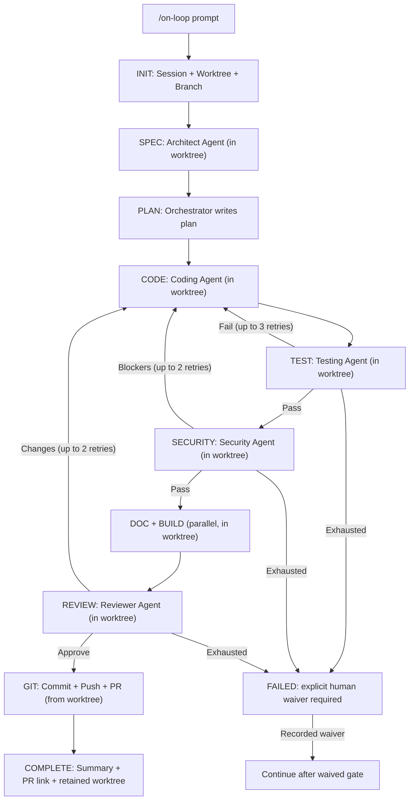

# On-Loop

Mirepoix's spec-driven SDLC workflow/bootstrap plugin for [Claude Code](https://docs.anthropic.com/en/docs/claude-code).

## What It Does

`/on-loop` supplies Claude Code with commands, agent prompts, skills, hooks, and workspace conventions for following this software development workflow:

```
Prompt → Worktree → Branch → Spec → Plan → Code → Test → Security → Docs + Build → Review → Commit + Push + PR → Done
```

Each phase has a specialist prompt that adopts the Staff Engineer and security posture defined in `shared/AGENT_PERSONA.md`. These are workflow instructions, not claims about a model's professional credentials.

The plugin is not an executable coordinator: Claude Code interprets the Markdown instructions and uses ordinary files and git commands. It does not mechanically enforce phase transitions, provide a complete JSONL event stream, or run an independent Codex “face-off.” Session files are reviewable records, but their completeness and ordering depend on the active Claude Code run.

`/on-loop` directs each session to use its own **git worktree**. The normal workflow retains that worktree after success for `/on-loop-continue` or manual inspection; `/on-loop:clear` removes it explicitly. Roadmap concurrency has additional limits described in [`commands/on-continue.md`](commands/on-continue.md).

## Installation

### Option 1: Marketplace (recommended)

Add the on-loop marketplace, then install the plugin:

```
/plugin marketplace add Mirepoix-AI/on-loop
```

This registers the marketplace from the repo's `marketplace.json`. Then install the plugin:

```
/plugin install on-loop
```

That's it — all `/on-loop` commands are now available in your Claude Code sessions.

> **How it works**: The `marketplace.json` at the repo root declares available plugins. When you run `/plugin marketplace add`, Claude Code fetches this manifest and makes the listed plugins available for install. `/plugin install` then activates the plugin, loading its commands, agents, skills, and hooks.

### Option 2: Clone to plugins directory

```bash
git clone https://github.com/Mirepoix-AI/on-loop.git ~/.claude/plugins/on-loop
```

### Option 3: Symlink

```bash
git clone https://github.com/Mirepoix-AI/on-loop.git ~/dev/on-loop
ln -s ~/dev/on-loop ~/.claude/plugins/on-loop
```

### Option 4: Project-local

Clone or copy into your project and reference it in your project's Claude Code configuration.

## Commands

| Command | Description |
|---------|-------------|
| `/on-loop <prompt>` | Run full SDLC loop with all agents |
| `/on-loop-check [PR number or branch]` | Check GitHub CI status, fix regressions, alert on pre-existing failures |
| `/on-loop-debug-fix [description or image]` | Debug and fix issues from infrastructure logs or user-provided context |
| `/on-loop-status` | Check progress of current and past sessions |
| `/on-loop-resume [--from=phase] [--session=<id>]` | Resume an interrupted loop |
| `/on-loop:clear [--include-logs]` | Clean up worktrees, optionally remove session logs |
| `/on-loop:main-resolve` | Pull main, merge into branch, resolve conflicts |
| `/on-spec <description>` | Standalone spec generation |
| `/on-test <target>` | Standalone test generation |
| `/on-security <target>` | Standalone security audit |
| `/on-doc <target>` | Standalone documentation generation |
| `/on-build <target>` | Standalone build/CI setup |
| `/on-review <target>` | Standalone code review |

### Roadmap Commands (Multi-Session)

| Command | Description |
|---------|-------------|
| `/on-prepare <prompt>` | Generate a roadmap with phases, steps, and acceptance criteria |
| `/on-plan [feature-slug]` | Read roadmap, produce detailed implementation plan |
| `/on-continue [feature-slug]` | Pick up next available step and execute through agent pipeline |
| `/on-pause [feature-slug]` | Release locks, commit WIP, write handoff summary |

## Safe release tagging

On 2026-05-20, untracked `.on-loop/sessions/` files caused `git pull` to abort silently (git refuses to overwrite untracked paths). The local branch was left one commit behind `origin/main`. The developer did not notice, signed the tag, and `v0.2.3` was created against the previous release's commit. The Quay image for v0.2.3 therefore contained v0.2.2 code.

`on-loop-tag` is a pre-flight gate that runs eight checks before invoking `git tag -s`, and writes a git-tracked NDJSON record to `.on-loop/release-log.json` on every outcome (success, refusal, or emergency bypass). Git history makes committed records reviewable but does not make the file immutable. The exact precondition of the v0.2.3 incident is caught by checks 5 and 6.

```bash
# Normal — all eight checks must pass
on-loop-tag v0.6.2 -m "release: v0.6.2"

# Dry run — check only, no tag, no audit line
on-loop-tag v0.6.2 -m "release: v0.6.2" --check

# Emergency bypass — all checks still run; failures become warnings
on-loop-tag v0.6.2 -m "hotfix" --force --reason "CI down, hotfix for prod INC-4892"
```

After a successful tag, push manually: `git push origin v0.6.2`

See [`bin/on-loop-tag.md`](bin/on-loop-tag.md) for the full manual: all eight checks, exit codes, audit log schema, `--force` policy, security considerations, and install trade-offs.

Installed to `~/.local/bin/on-loop-tag` by `setup/fedora-bootstrap.sh`.

This tool implements the **canonical-state-verification iteration** of [mise-en-place Principle 5 (Justified Action / Five Whys), §5 Forward](https://github.com/Mirepoix-AI/mise-en-place/blob/main/skills/mise-en-place/references/contract.md#5-justified-action) — applied to `git tag` operations. The eight pre-flight checks are the reference pattern for destructive-op tooling; the discipline generalizes to schema migrations, deployments, and any irreversible operation. See mise-en-place v0.5.1 (2026-05-21) for the architectural authority.

## Agents

| Agent | Model | Role |
|-------|-------|------|
| Orchestrator | Opus | Pipeline control, quality gates, retry logic, worktree/session lifecycle |
| Architect | Opus | Spec generation, ADRs, system design |
| Coding | Opus | Implementation with security-first practices |
| Testing | Sonnet | Unit, integration, and E2E tests |
| Security | Opus | OWASP/STRIDE audit, compliance checks (read-only) |
| Documentation | Sonnet | READMEs, guides, CLAUDE.md files |
| Build | Sonnet | Makefile, GitHub Actions, lint/security configs |
| Reviewer | Opus | Final code review gate (read-only) |

## Architecture



### Worktree Isolation

Each session creates a git worktree at `.claude/worktrees/<branch-slug>/`, providing an independent working directory. This means:

- Feature-file checkouts are isolated between worktrees; shared `.on-loop/index.json` updates still rely on Claude following the workflow
- The workflow directs feature edits to the worktree rather than the invoking checkout
- Each session has its own branch and isolated file state
- Worktrees share the git object store, so they are space-efficient

### Session Logs

Each session persists its state under `.on-loop/sessions/<YYYYMMDD_HHMMSS_branch-slug>/`:

```
.on-loop/
├── index.json                  # Manifest of all sessions
└── sessions/
    ├── 20260426_143052_user-management-api/
    │   ├── state.json          # Phase tracking
    │   ├── plan.md             # Implementation plan
    │   ├── changes.log         # File modification log
    │   └── agent-notes/        # Per-agent structured output
    └── 20260426_150311_auth-middleware/
        └── ...
```

Session directories are named with timestamps for chronological sorting and branch slugs for human readability.

Session directories are intended to be committed as operational records of what the workflow reported. They are ordinary, editable git-tracked files—not immutable or mechanically complete audit logs.

### Quality Gates

Each phase transition is validated:

| Transition | Key Criteria |
|-----------|--------------|
| CODE -> TEST | Code compiles, no self-reported critical issues |
| TEST -> SECURITY | All tests pass |
| SECURITY -> DOC/BUILD | No critical/high security findings |
| REVIEW -> GIT | Reviewer approves |
| GIT -> COMPLETE | Commit, push, PR created |

Failed gates trigger retries (TEST->CODE: 3x, SECURITY->CODE: 2x, REVIEW->CODE: 2x). After exhaustion, the workflow stops in `FAILED`. Continuing requires a human to explicitly waive the unresolved issues; the orchestrator records the waiver in `state.json` and `changes.log` before proceeding.

## Agent Persona

The agent prompts request a **Staff Software Engineer** perspective informed by ISC2 bodies of knowledge (CISSP, CCSP, CSSLP, ISSAP, ISSEP, ISSMP), targeting:

- Regulated financial services (banking, trading, insurance)
- Critical infrastructure
- Multi-tenant SaaS

Security principles: zero trust, defense in depth, least privilege, fail secure, secure by default.

Compliance awareness: SOC2, PCI-DSS, NIST 800-53, ISO 27001, GDPR.

## Example Usage

### Full SDLC Loop

```
/on-loop Create a REST API for user management with JWT authentication, role-based access control, and PostgreSQL storage
```

### Concurrent Sessions

```
# Terminal 1
/on-loop Add user registration with email verification

# Terminal 2 (same repo, different Claude Code session)
/on-loop Add password reset flow with OTP
```

Each is directed to its own feature worktree. This isolates checked-out feature files, but the plugin does not provide atomic coordination for shared session metadata.

### Standalone Commands

```
/on-security src/auth/           # Audit auth module
/on-test src/api/handlers.ts     # Generate tests for handlers
/on-doc                          # Document the entire project
/on-review                       # Review all uncommitted changes
```

### Resume After Interruption

```
/on-loop-status                           # Check all sessions
/on-loop-resume                           # Resume most recent active/failed session
/on-loop-resume --session=20260426_143052_user-api --from=TEST  # Resume specific session
```

### Cleanup

```
/on-loop:clear                  # Remove worktrees, keep session logs
/on-loop:clear --include-logs   # Also remove session records; preserve release records
```

## Project Structure

```
on-loop/
├── .claude-plugin/plugin.json   # Plugin metadata (v0.6.1)
├── .on-loop/                    # Session logs (committed to repo)
│   ├── index.json               # Session manifest
│   └── sessions/                # Per-session state and agent notes
├── hooks/hooks.json             # Stop + PostToolUse hooks
├── commands/                    # 18 user-invocable commands
├── agents/                      # 8 specialist agent definitions
├── skills/                      # Loop state + quality gate + roadmap skills
├── shared/                      # Shared persona, protocols, standards
├── CLAUDE.md                    # Plugin instructions
├── README.md                    # This file
└── LICENSE                      # Apache 2.0
```

## License

Apache 2.0 — see [LICENSE](LICENSE).
